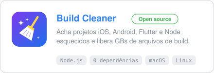
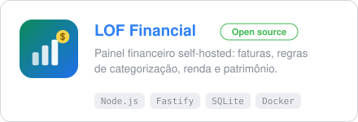
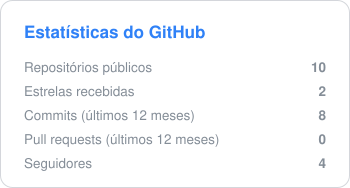
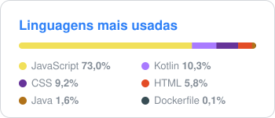

# Leonardo Fazanaro

**Desenvolvedor mobile · Android & iOS · criador da LOF Studio**

Crio apps nativos em Kotlin, Java e Swift, além de ferramentas web self-hosted para uso pessoal.

---

### 🛠️ Stack

  
  
  
  
  
   
  
  
  
  
  
  
  
  

### 🚀 Projetos em destaque

  
  

**🧹 [Build Cleaner](https://github.com/leofazanaro/Build-junk-cleaner)**: encontra projetos iOS, Android, Flutter, React Native e Node esquecidos no disco e libera gigabytes de `DerivedData`, `.gradle`, `build/` e `node_modules` com um clique. Roda local, sem nenhuma dependência além do Node.js.

**💳 [LOF Financial](https://github.com/leofazanaro/LOF_Financial)**: painel financeiro pessoal self-hosted. Importa faturas, categoriza gastos por regras e acompanha renda e patrimônio.

### 📊 Estatísticas

  
  

